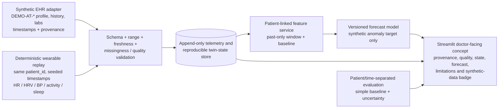

# Atria Twin — Challenge Compliance and Architecture Audit

**Audit date:** 2026-10-23  
**Scope:** Updated after Phase 2 implementation in the nested source project. New source modules, tests, documentation, and a separately versioned synthetic evaluation were added. Existing datasets and prior model artifacts were preserved; the running server and Windows security settings were not changed.

## Executive finding

Atria Twin is a **synthetic digital-twin proof of concept**, not a clinically validated cardiovascular event predictor. The source-tree Digital Twin now connects a selected fictional patient record, a stable patient ID, deterministic timestamped telemetry replay, chronological twin state, and a past-only 30-minute simulated-anomaly trend rule. Manual sensor overrides, replay controls, forecast refresh, and scenario controls have been wired and tested. This does not establish clinical utility or real-event prediction.

The patient-linked forecast is a prespecified heuristic, not a fitted model or probability. Its static baseline comes from the selected fictional patient's record; telemetry and manual overrides are session-only synthetic data. Its rule target and evaluation labels are simulator-generated and must never be presented as observed clinical outcomes. The previous fitted UCI-context model is still separate and unlinked from the selected patient; all prior v1/v2 artifacts remain untouched. Twin state is reproducible only within a Streamlit session, not durable across browser sessions or process restarts.

The dashboard entry point is `streamlit run atria_twin/app.py`. The source code was exercised through Streamlit AppTest; the existing port-8501 process continues to serve the prior temporary runtime copy and was not restarted or edited. Source/runtime differences are summarized in [COPY_COMPARISON.md](./COPY_COMPARISON.md).

## Evidence-based gap matrix

| # | Requirement / status | Implementation and end-to-end evidence | Tests and metrics currently available | Gap and smallest safe next action |
|---|---|---|---|---|
| 1 | **Static/historical patient EHR data — PARTIAL** | [atria_twin/patient_records.py](./atria_twin/patient_records.py): `SYNTHETIC_PATIENTS`, `PatientRecord`, `LabResult`, `BloodPressureReading`, and `build_patient_timeline()` provide three stable fictional `DEMO-AT-*` profiles with demographics, history, diagnoses, medications, family history, dated labs, and BP/wearable baselines. [atria_twin/patient_dashboard.py](./atria_twin/patient_dashboard.py) renders the selected record. | `tests/test_patient_workflow.py` covers patient selection, same-ID fusion, missing/stale disclosures, and fail-closed risk handling. No clinical outcomes exist. | Hand-authored demo data only: no EHR import/API, FHIR resources, or production store. Keep synthetic disclosure; a real EHR adapter requires approved data and governance. |
| 2 | **Dynamic wearable/IoT time series — PARTIAL** | [atria_twin/patient_twin_pipeline.py](./atria_twin/patient_twin_pipeline.py): `generate_patient_telemetry()`, `tick_replay()`, `advance_replay()`, and `update_twin_state()` provide deterministic patient-keyed 5-minute telemetry with timestamps, units, missingness, and provenance. [atria_twin/patient_twin_dashboard.py](./atria_twin/patient_twin_dashboard.py) exposes start/pause/resume/step/reset/speed and session-only manual overrides. | `tests/test_patient_twin_pipeline.py` covers deterministic generation, replay timing, missing/stale readings, and chronological state. `tests/test_patient_twin_dashboard.py` verifies interactive input and reset. No device or real IoT source is connected. | The stream is synthetic replay, not live device ingestion. Maintain explicit source/quality labels; add a governed device adapter only if approved. |
| 3 | **Fusion of both streams for the same virtual patient — PASS (synthetic prototype)** | `render_patient_twin_replay()` in [atria_twin/patient_twin_dashboard.py](./atria_twin/patient_twin_dashboard.py) passes the selected `PatientRecord` to `generate_patient_telemetry()` and the forecast; both use its stable `patient_id`. The recorded wearable/BP baseline is included with past-only replay features in [atria_twin/patient_twin_pipeline.py](./atria_twin/patient_twin_pipeline.py). Prior UCI-context v1/v2 fitted models remain separate and unlinked. | `tests/test_patient_twin_pipeline.py` asserts patient linkage, deterministic replay, feature boundaries, and no future leakage; dashboard AppTest exercises a selected patient's state and controls. | This is fusion of synthetic history/baseline and simulated telemetry only; diagnosis/lab fields are not learned prediction covariates. No clinical patient/outcome linkage exists. |
| 4 | **Defined future target and horizon — PASS (simulation-only)** | `future_target()` and `forecast_patient_anomaly()` in [atria_twin/patient_twin_pipeline.py](./atria_twin/patient_twin_pipeline.py) define a positive target as at least two consecutive future 5-minute values within 30 minutes crossing HR, RMSSD, and systolic-BP thresholds relative to the selected patient's recorded synthetic baseline. Features are derived from the preceding 30-minute window at/before the forecast cutoff. | Unit tests check horizon bounds and future-data independence. The dashboard displays target/horizon and identifies this as a synthetic trend projection. | No observed clinical outcomes or real adverse event labels exist. Continue calling it a synthetic abnormal-physiology/anomaly forecast only. |
| 5 | **Working, reproducible model and appropriate evaluation — PARTIAL** | Patient-linked `forecast_patient_anomaly()` is a fixed, versioned linear trend rule; it is not a fitted ML model or probability. `evaluate_patient_twin_forecast()` and [atria_twin/evaluate_patient_twin.py](./atria_twin/evaluate_patient_twin.py) reproduce the evaluation at `artifacts/patient_twin_forecast_v1_1/evaluation.json`. Separate existing `simulated_forecast.py` v1/v2 model artifacts were preserved. | Seed `20261023`; 300 synthetic episodes (100 per each of three hand-authored templates), 36 positive/264 negative generated labels. Trend rule: accuracy **0.9367**, balanced accuracy **0.7481**, precision **0.9474**, recall **0.5000**, F1 **0.6545**, confusion `[[263,1],[18,18]]`. Last-reading persistence baseline: accuracy **0.9000**, balanced accuracy **0.5833**, precision **1.0000**, recall **0.1667**, F1 **0.2857**, confusion `[[264,0],[30,6]]`. No train/test split applies to a prespecified rule; no confidence interval is reported because only three templates exist. | Results measure agreement with the same synthetic generator, not clinical utility or population performance. No fitted model, calibration, independent cohort, or clinical validation. Preserve old v1/v2 artifacts; next priority is broader independent synthetic templates and time-separated evaluation only if useful for simulator robustness. |
| 6 | **Conceptual doctor-facing dashboard — PASS (prototype scope)** | [atria_twin/app.py](./atria_twin/app.py) integrates the selected patient view, replay/state, forecast and scenarios into the Digital Twin workspace. [atria_twin/patient_twin_dashboard.py](./atria_twin/patient_twin_dashboard.py) renders provenance, freshness/missingness, inputs, forecast, and controls. `assess_cardiovascular_risk()` still fails closed for clinical risk. The source tree is served separately on port 8502; the existing port 8501 runtime was left untouched. | `tests/test_patient_twin_dashboard.py` exercises replay, manual telemetry override, reset, scenario recomputation, and Streamlit exception prevention. The selected suite now reports **169 passed**, 35 pandas deprecation warnings. AppTest and browser checks verified source interactions; HTTP health is not clinical or model validation. | This remains a conceptual research dashboard, not a clinical workflow/deployment. State is session-scoped and not durable. |
| 7 | **Public-repository-ready GitHub structure and README — PARTIAL** | The inner source root contains `atria_twin/`, `tests/`, `docs/`, `artifacts/`, `deliverables/`, `tools/`, `requirements.txt`, `.gitignore`, and [README.md](./README.md). [deliverables/GITHUB_PUBLICATION_CHECKLIST.md](./deliverables/GITHUB_PUBLICATION_CHECKLIST.md) records publication as not published/not verified. | Tests were run in an isolated Python 3.12.10 environment; current source `.venv` has an incomplete SciPy installation and pytest is absent. The current audit shell could not run `git` because the Git executable is unavailable. | No public URL/visibility or working Git remote was verified. README and architecture/model-card passages still refer to v1 metrics or say v2 has not been verified, despite the later v2 verification in [COPY_COMPARISON.md](./COPY_COMPARISON.md); root README also mixes legacy classifier material with the Atria Twin project. Reconcile documentation to evidence, choose and verify the publication root, then perform owner-approved secret/data-rights review and verify a public URL. Do not publish local data or partial waveforms without rights review. |
| 8 | **Open-source license — PASS (project code only)** | [LICENSE](./LICENSE) contains the MIT License. | No license-specific test. [deliverables/GITHUB_PUBLICATION_CHECKLIST.md](./deliverables/GITHUB_PUBLICATION_CHECKLIST.md) distinguishes project-code licensing from third-party data rights. | Confirm copyright-holder authority and separately review bundled UCI/LTAFDB data, model artifacts, and assets before public redistribution. The MIT file does not license those third-party materials. |
| 9 | **Architecture diagram PDF/PPT — PASS (local deliverables)** | Editable source [docs/architecture.mmd](./docs/architecture.mmd), notes [docs/ARCHITECTURE.md](./docs/ARCHITECTURE.md), [deliverables/Atria_Twin_Architecture.pdf](./deliverables/Atria_Twin_Architecture.pdf), and [deliverables/Atria_Twin_Architecture.pptx](./deliverables/Atria_Twin_Architecture.pptx) are present in the inner project root. | Files are present and locally readable by path; this audit did not re-render or independently inspect every slide/page. | Reconcile the diagram's v1/v2 and blocked-status wording against this audit, visually review the exports, then include them in the owner-approved public submission. |
| 10 | **Presentation PDF/PPT — PASS (local deliverables)** | [deliverables/Atria_Twin_Summit_Presentation.pdf](./deliverables/Atria_Twin_Summit_Presentation.pdf) and [deliverables/Atria_Twin_Summit_Presentation.pptx](./deliverables/Atria_Twin_Summit_Presentation.pptx) are present. [docs/SUMMIT_PRESENTATION_OUTLINE.md](./docs/SUMMIT_PRESENTATION_OUTLINE.md) and [docs/SUMMIT_DEMO_SCRIPT.md](./docs/SUMMIT_DEMO_SCRIPT.md) provide supporting content. | Deliverable presence verified from the project tree; this audit did not re-render or independently review slide content. | Check all slides for accurate v2 status, synthetic-only labels, data attribution, and readable export before publication. |
| 11 | **Demonstration video ≥20 minutes — FAIL** | [deliverables/DEMO_RECORDING_CHECKLIST.md](./deliverables/DEMO_RECORDING_CHECKLIST.md) says the presenter-led recording is pending and the planned MP4 does not exist. The available [deliverables/Atria_Twin_Silent_Dashboard_Preview.avi](./deliverables/Atria_Twin_Silent_Dashboard_Preview.avi) is identified by the checklist as a 30-second silent preview, not the required recording. A timed 20-minute script exists in [docs/SUMMIT_DEMO_SCRIPT.md](./docs/SUMMIT_DEMO_SCRIPT.md). | No qualifying continuous narrated video or verified ≥20-minute playback evidence is present. | Record and playback-check a continuous narrated 20–22 minute walkthrough using the existing script. Keep the video marked pending until the final file opens and actual duration/audio are verified. |

## Target architecture recommendation

Use one stable synthetic patient identity end-to-end for the competition demonstration. Keep the UCI prevalent-label classifier and LTAFDB research gate as clearly separate workspaces; neither is the linked digital-twin forecast.

**Required boundary:** until approved, linked real longitudinal data and defensible event labels exist, the forecast outcome remains a *simulated abnormal-physiology target*. The synthetic EHR and wearable sources should share a stable patient ID and reproducible timestamps; data source, model version, forecast window, horizon, quality, and label provenance should travel with every displayed result. State persistence must not promote low-quality/out-of-range observations into a patient's baseline.

## Prioritized shortest safe implementation path

1. **Protect current evidence and establish a clean candidate root.** Keep port 8501, its `%TEMP%\\atria_twin_dashboard_6730286a` runtime copy, all prior model versions, datasets, and reports unchanged. The inner project root remains the source for Phase 2; preserve the source/runtime comparison.
2. **Patient-linked synthetic replay and forecast — implemented in source.** The selected `DEMO-AT-*` patient history/baseline, deterministic telemetry replay, chronological state, fixed 30-minute trend forecast, manual synthetic telemetry input, and scenario controls now share the stable patient ID. Existing UCI classifier and v1/v2 artifacts remain separate and untouched.
3. **Make the twin update durable.** Replay/twin state currently persists only within a Streamlit browser session. A governed, append-only store and restart-safe replay are future work; do not persist session-only manual overrides as patient records.
4. **Strengthen simulator evaluation cautiously.** The v1.1 rule evaluation compares persistence baseline and reports uncertainty limitations, but only three hand-authored templates exist. If more synthetic robustness work is undertaken, expand templates and use time-separated tests; this still cannot provide clinical validity.
5. **Reconcile submission documentation and exports.** README/model card/architecture notes now describe the source-tree v1.1 path; refresh and visually review PDFs/PPTs only after content is stable. Retain the static UCI and LTAFDB paths as separate tasks.
6. **Close submission deliverables.** Owner-review the license and dataset redistribution scope; verify the public repository URL and clean publication contents; re-export and visually review the architecture/presentation files; then record and playback-check the required continuous narrated video of at least 20 minutes. The video is the clearest hard deliverable blocker.

## Runtime and copy evidence

- **Run command:** from the inner project root, `streamlit run atria_twin/app.py`. Root `app.py` is a separate legacy classifier, not the current Atria Twin entry point.
- **Current serving copy:** `<LOCAL_TEMP_DIR>/atria_twin_dashboard_6730286a/atria_twin/app.py`, served on `127.0.0.1:8501`. The process IDs/command, source-vs-runtime hashes, and previous health checks are recorded in [COPY_COMPARISON.md](./COPY_COMPARISON.md). During this audit the health endpoint returned `200 / ok`; no server action was taken.
- **Version difference:** the source and runtime `atria_twin/` trees matched in the prior SHA-256 comparison, but four of 87 corresponding artifact files differed: forecast model/evaluation and static-model artifact/evaluation. The source forecast model code declares v2 while its saved forecast artifact/evaluation are v1; runtime has v2. Prior isolated verification reproduced runtime v2 evaluation and holdout probabilities exactly. Do not copy or promote an artifact based on its filename or timestamp.
- **Runtime blocker:** source `.venv` is Python 3.12.10 with a missing SciPy module required by scikit-learn. The separate `%TEMP%\\atria_twin_verify_20261023` environment was used for successful model/test verification; no source environment repair or security change was made.
- **Test currency:** the Phase 3 selected suite passed **169 tests** in the isolated environment, with 35 pandas deprecation warnings (two from WFDB and 33 from Streamlit chart rendering). These are software checks, not clinical validation. The source `.venv` SciPy issue was not repaired.
- **UCI classifier distinction:** `atria_twin/static_model.py::train_static_model()` predicts the UCI dataset's existing prevalent `num > 0` label (not a future event). The separately saved UCI holdout report has accuracy 0.8424, balanced accuracy 0.8387, precision 0.8476, recall 0.8725, average precision 0.9223, ROC-AUC 0.9102, and Brier score 0.1191 on a stratified random 20% row holdout (184 records). These metrics must not be attributed to the simulated forecast or a real patient.
- **Research-data boundary:** the LTAFDB path remains separate and blocked by incomplete waveform acquisition, strict record-30 validation failure, and unverified XQRS temporal causality. Do not imply an AF model or clinical validation exists; see [CLEANUP_PLAN.md](./CLEANUP_PLAN.md) and [COPY_COMPARISON.md](./COPY_COMPARISON.md).

## Audit conclusion

The source tree now demonstrates a coherent, patient-linked **synthetic** replay and 30-minute anomaly trend rule, with session-state updates, missing/stale signal handling, manual synthetic sensor overrides, neutral-by-default scenario comparison, and a persistence baseline comparison. It is not a fitted model, clinical risk predictor, or validated event forecast. The static UCI classifier and the older combined-input UCI-context v1/v2 model remain separate tasks. State is not durable beyond the browser session; only three fictional templates support the new evaluation. A public repository was not verified and the required ≥20-minute narrated video remains absent. See the Phase 3 verification addendum below.

## Phase 3 dashboard verification addendum — 2026-10-23

- The canonical nested source dashboard is running at `http://127.0.0.1:8502/` from the isolated Python 3.12.10 environment. Its health endpoint returned HTTP 200 (`ok`) and its listener PID was 29228 at the final check.
- The pre-existing runtime snapshot remains at `http://127.0.0.1:8501/`, listener PID 4404; its health endpoint also returned HTTP 200 (`ok`). It was not restarted, stopped, or edited.
- The exact selected test command (using `PYTHONDONTWRITEBYTECODE=1`, `-p no:cacheprovider`, and `--import-mode=importlib`) completed with **169 passed, 35 warnings in 34.52 seconds**. Two warnings originate in WFDB and 33 in Streamlit chart rendering.
- Browser/AppTest verification confirmed neutral scenario defaults, baseline-versus-scenario recomputation, replay control behavior, and that **Reset to Baseline** no longer raises `StreamlitWidgetAlreadyInstantiatedError`. Scenario assumptions remain illustrative and non-causal.
- Synthetic evaluation, previous model artifacts, source datasets, LTAFDB Record 30 header/annotations, and port-8501 runtime copy were preserved. This phase does not claim clinical validation, durable state, or real adverse-event prediction. Submission exports have not been regenerated or visually re-reviewed; the narrated video remains unrecorded.
