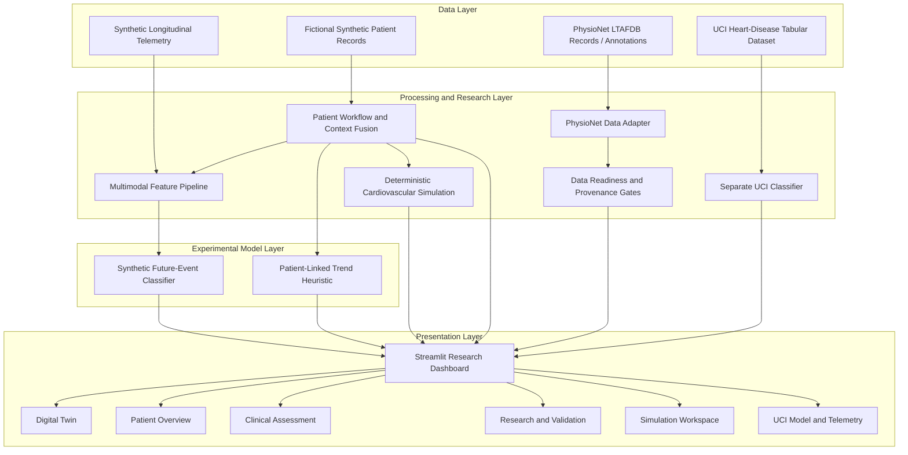

# Atria Twin — AI-Powered Cardiovascular Digital Twin


**Team:** S3P
**Institution:** KPR Institute of Engineering and Technology
**Project Domain:** Healthcare AI · Digital Twins · Machine Learning · Cardiovascular Simulation

> **From static health predictions to dynamic cardiovascular insights.**

Atria Twin is a cardiovascular digital-twin research prototype that brings together fictional patient context, longitudinal physiological telemetry, deterministic cardiovascular simulation, and machine-learning experiments in an interactive research environment.

**Clinical status: NOT CLINICALLY VALIDATED.** Atria Twin is intended for research and demonstration, not diagnosis, screening, triage, treatment, or medical decision-making.

---

## Table of Contents

* [Overview](#overview)
* [Problem Statement](#problem-statement)
* [Research Objectives](#research-objectives)
* [Key Features](#key-features)
* [System Architecture](#system-architecture)
* [Core Research Components](#core-research-components)
* [Synthetic Future-Event Experiment](#synthetic-future-event-experiment)
* [Patient-Linked Digital-Twin Replay](#patient-linked-digital-twin-replay)
* [Dashboard Workspaces](#dashboard-workspaces)
* [Data Sources and Provenance](#data-sources-and-provenance)
* [Model Evaluation](#model-evaluation)
* [Technology Stack](#technology-stack)
* [Installation and Quick Start](#installation-and-quick-start)
* [Testing and Reproducibility](#testing-and-reproducibility)
* [Repository Structure](#repository-structure)
* [API and Deployment](#api-and-deployment)
* [Limitations and Responsible Use](#limitations-and-responsible-use)
* [Future Work](#future-work)
* [Team](#team)
* [License](#license)

---

## Overview

Cardiovascular measurements evolve over time. A single measurement may not show how it differs from a person's baseline, how multiple signals change together, or whether the available observations are incomplete or outdated.

Atria Twin explores a digital-twin-style workflow for organizing patient context and chronological physiological observations into an interactive environment.

The project combines several research components:

* **Synthetic patient records:** fictional patient profiles and EHR-like context.
* **Longitudinal telemetry:** generated physiological measurements and time-series processing.
* **Multimodal machine learning:** experimental classification against a defined synthetic event rule.
* **Deterministic cardiovascular simulation:** a separate engine for simulated state transitions and scenarios.
* **Patient-linked replay:** baseline-relative trend visualization for fictional patient templates.
* **Exploratory ECG processing:** limited waveform and annotation workflows involving PhysioNet's Long-Term AF Database.
* **Legacy UCI classification:** a separate model for an existing tabular dataset label.
* **Research safeguards:** data-readiness checks, provenance controls, validation reports, and automated tests.

These components have different purposes and evidence levels. Their results must not be interpreted as one unified, clinically validated cardiovascular prediction system.

## Problem Statement

Static health-prediction demonstrations often focus on a single row of clinical measurements. They provide limited visibility into the chronological evolution of physiological signals, changes relative to a baseline, and the assumptions behind simulated or model-generated outputs.

Atria Twin explores an alternative research workflow that combines fictional patient context with longitudinal physiological observations, deterministic simulation, and experimental machine learning.

The objective is to make cardiovascular-style data easier to inspect over time while keeping model outputs, synthetic labels, and limitations explicit.

## Research Objectives

1. Develop an interactive cardiovascular digital-twin research interface.
2. Represent fictional patient profiles and longitudinal physiological observations.
3. Explore baseline-relative telemetry analysis and chronological replay.
4. Experiment with multimodal feature processing and synthetic future-event classification.
5. Compare machine-learning outputs with simpler deterministic or persistence-based approaches where applicable.
6. Separate simulated behavior from trained model inference and dataset-specific classification.
7. Maintain transparent data provenance, evaluation evidence, and clinical-use safeguards.

---

## Key Features

### 1. Multimodal research pipeline

The project includes a pipeline intended to combine synthetic patient context with longitudinal physiological telemetry.

The documented signals include heart rate, RMSSD, blood pressure, SpO₂, sleep, activity, and stress-related inputs, depending on the particular workflow.

The exact inputs used by a given model must be confirmed from its feature-extraction code and saved evaluation report.

### 2. Deterministic cardiovascular simulation

The simulation subsystem contains an engine, state definitions, scenario configurations, and visualization components.

It is designed to demonstrate simulated cardiovascular-state transitions and comparisons between illustrative scenarios.

Simulation output is not a real patient's physiological state, and simulation behavior does not by itself establish clinical validity.

### 3. Patient-linked replay

The Digital Twin workflow links fictional patient templates with synthetic telemetry and baseline-relative visualization.

The documented patient-linked forecast path uses a deterministic trend heuristic. It must not be represented as a trained or calibrated patient-specific clinical probability.

### 4. Interactive dashboard

The Streamlit application brings multiple research workflows into one interface, including patient overview, digital-twin replay, clinical assessment, research validation, simulation, and the separate UCI model.

### 5. Research safeguards

The architecture includes data-readiness and provenance-related modules, validation documentation, a model card, and tests for application behavior and safeguards.

These mechanisms support software verification and research transparency. They do not substitute for clinical validation.

---

## System Architecture

### High-level architecture



This diagram represents the documented conceptual architecture. It does not imply that all components share one model or that every input source contributes to every output.

### Architectural principles

* **Separation of tasks:** synthetic-event classification, deterministic replay, cardiovascular simulation, and UCI classification remain distinct.
* **Temporal discipline:** forecasting features should use only observations available at prediction time. This property must be verified in the specific implementation before claiming leakage-free evaluation.
* **Data provenance:** external data workflows should record source, version, record boundaries, and annotation assumptions.
* **Explicit synthetic scope:** generated profiles, simulated states, and generated labels must be identified as such.
* **Clinical safeguards:** the interface must not imply a validated diagnosis or probability where none is computed.
* **Reproducibility:** reported metrics should be traceable to the corresponding model artifact, evaluation report, and split definition.

### Core implementation modules

| Module                                              | Responsibility described in the project                        |
| --------------------------------------------------- | -------------------------------------------------------------- |
| `atria_twin/app.py`                                 | Main Streamlit application                                     |
| `atria_twin/patient_dashboard.py`                   | Patient-facing dashboard workspaces                            |
| `atria_twin/patient_records.py`                     | Fictional patient records and EHR-like context                 |
| `atria_twin/patient_workflow.py`                    | Patient navigation and timeline synthesis                      |
| `atria_twin/patient_twin_pipeline.py`               | Telemetry windowing, baseline computation, and feature fusion  |
| `atria_twin/multimodal_pipeline.py`                 | Multimodal feature extraction, model definition, and inference |
| `atria_twin/model_validation.py`                    | Model-validation status and evaluation evidence                |
| `atria_twin/validate_multimodal_model.py`           | Validation and benchmark-generation script                     |
| `atria_twin/train_multimodal_model.py`              | Multimodal model training pipeline                             |
| `atria_twin/data_readiness.py`                      | Data ingestion and readiness checks                            |
| `atria_twin/data_gate.py`                           | Provenance and anti-fabrication checks                         |
| `atria_twin/forecast_dashboard.py`                  | Forecast visualizations                                        |
| `atria_twin/prediction_api.py`                      | Prediction interface                                           |
| `atria_twin/runtime_dependencies.py`                | Runtime dependency checks                                      |
| `atria_twin/MODEL_CARD.md`                          | Intended use, limitations, and safety documentation            |
| `atria_twin/simulation/engine.py`                   | Deterministic cardiovascular simulation engine                 |
| `atria_twin/simulation/scenarios.py`                | Simulation scenarios                                           |
| `atria_twin/simulation/state.py`                    | Simulation state definitions and invariants                    |
| `atria_twin/simulation/visualization.py`            | Simulation trend visualizations                                |
| `atria_twin/ui/theme.py`                            | UI styling                                                     |
| `atria_twin/ui/charts.py`                           | Chart components                                               |
| `atria_twin/ui/heart_3d.py`                         | 3D heart visualization component                               |
| `atria_twin/datasets/physionet_wearable_adapter.py` | PhysioNet/LTAFDB adapter                                       |
| `atria_twin/datasets/physionet_wearable_preview.py` | Wearable-data preview workspace                                |
| `api/predict.py`                                    | HTTP prediction endpoint source                                |
| `api/health.py`                                     | HTTP health endpoint source                                    |

Verify these paths against the final repository before publication.

---

## Core Research Components

### A. Multimodal synthetic-event experiment

This experiment uses generated patient context and physiological time-series windows to classify a synthetic event label.

Its evaluation measures agreement with the synthetic label-generation process—not prediction of real cardiovascular emergencies.

### B. Patient-linked deterministic replay

This workflow uses fictional patient templates and timestamped synthetic telemetry to visualize baseline-relative changes.

The documented replay uses a fixed trend heuristic rather than the trained multimodal model. Its output must be labelled as simulated and heuristic.

### C. Cardiovascular simulation engine

The simulation subsystem defines state transitions and illustrative physiological scenarios.

It is separate from both the synthetic classifier and the patient-linked trend heuristic. Its simulated outputs should not be presented as clinical observations or proof of physiological accuracy.

### D. UCI heart-disease classifier

The legacy tabular pipeline predicts an existing UCI dataset label, described in this project as `num > 0`.

It is a separate classification task and is not a prospective cardiovascular-event model.

### E. Exploratory ECG workflow

The project contains an exploratory workflow for PhysioNet LTAFDB records and annotations.

The described work is limited and does not establish validated atrial-fibrillation detection or prediction capability.

---

## Synthetic Future-Event Experiment

### Target definition

The described synthetic event rule labels an event when at least two consecutive future five-minute readings within a 30-minute horizon satisfy all of the following conditions relative to the generated baseline:

```text
heart_rate_bpm >= baseline_hr + 18
rmssd_ms <= baseline_rmssd * 0.65
systolic_mmhg >= baseline_sbp + 15
```

This is a generated anomaly/event rule. It is **not a clinically established definition** of a heart attack, stroke, or major adverse cardiovascular event.

A model trained on these labels may learn the rules embedded in the generator. High performance therefore does not establish real-world clinical performance.

### Reported evaluation runs

Development notes contain metrics from different experiments. The runs must remain separate.

| Evaluation                       | Reported setup                                                                             | Reported results                                                                                                                                            | Qualification                                                          |
| -------------------------------- | ------------------------------------------------------------------------------------------ | ----------------------------------------------------------------------------------------------------------------------------------------------------------- | ---------------------------------------------------------------------- |
| Earlier synthetic-window run     | 1,800 held-out windows from 90 synthetic patients                                          | ROC-AUC `0.9991`; PR-AUC `0.9947`; F1 `0.9751`; balanced accuracy `0.9872`; precision `0.9690`; recall `0.9812`; specificity `0.9932`; Brier score `0.0070` | Verify against the matching saved evaluation report before publication |
| Earlier wearable-only comparison | Separate model comparison                                                                  | ROC-AUC `0.9990`; PR-AUC `0.9940`; F1 `0.9750`; persistence baseline F1 `0.6842`                                                                            | Does not establish that multimodal inputs improve performance          |
| Separate v2 synthetic-cohort run | 300 generated profiles: 225 training and 75 holdout; 1,500 held-out windows; seed `240823` | Accuracy `0.9673`; precision `0.8340`; recall `0.9779`; F1 `0.9002`; AUROC `0.9864`; confusion matrix `[[1230, 44], [5, 221]]`                              | Separate run with its own artifact and report                          |

**These values are not one combined metric set.** Before publishing them as verified results, inspect the matching evaluation reports, model artifacts, split definitions, and target configurations. Remove any result that cannot be traced to its corresponding experiment.

Artifact paths referenced in development notes include:

```text
artifacts/multimodal_twin/multimodal_event_model.joblib
artifacts/multimodal_twin/validation_metrics.json
artifacts/multimodal_twin/validation_report.md
```

Earlier versions may use a different evaluation filename. Confirm the actual files in the release commit.

### Interpreting the results

* ROC-AUC measures ranking performance across thresholds.
* PR-AUC depends on the prevalence of the positive class.
* Precision and recall depend on the selected operating threshold.
* Brier score alone does not establish calibration.
* Patient/profile-separated splits can reduce leakage risk, but the implementation and split manifest must be inspected before claiming leakage-free evaluation.
* Synthetic-only evaluation does not establish external clinical validity or clinical utility.

---

## Patient-Linked Digital-Twin Replay

Development notes describe the versioned workflow `patient-linked-synthetic-trend-v1.1`.

The replay is based on three fictional patient templates. It uses seven timestamped readings sampled at five-minute intervals—approximately a 30-minute trailing window—and linearly projects selected measurements over the following 30 minutes.

The replay is intended to demonstrate:

* Chronological synthetic telemetry playback.
* Baseline-relative heart-rate, RMSSD, and systolic blood-pressure trends.
* Missing or incomplete observation-window handling.
* Session-scoped playback and manual illustrative overrides.
* Comparison of baseline and illustrative scenario views.

The patient-linked replay is a **deterministic trend heuristic**, not a trained or calibrated patient-specific clinical probability. Scenario changes are illustrative perturbations, not proof of causal medical effects.

A development note documents this evaluation command:

```powershell
$env:PYTHONDONTWRITEBYTECODE = '1'
python -m atria_twin.evaluate_patient_twin --episodes-per-patient 100 --seed 20261023
```

Run it only if the referenced module exists in the release version. Verify the output and evaluation report before using them as evidence. An evaluation involving three hand-authored synthetic templates does not establish generalization to a wider population.

---

## Dashboard Workspaces

The following descriptions reflect the supplied project summary. Confirm the current application renders each workspace before treating it as a verified release feature.

| Workspace                         | Purpose                                                                                                                         | Important boundary                                                                              |
| --------------------------------- | ------------------------------------------------------------------------------------------------------------------------------- | ----------------------------------------------------------------------------------------------- |
| **Digital Twin**                  | Selected fictional patient, synthetic telemetry replay, baseline-relative state, missingness/freshness, and trend visualization | Patient-linked forecast is heuristic unless a different verified model is explicitly identified |
| **Patient Overview**              | Fictional patient context, diagnoses, medications, labs, blood pressure, wearable observations, and trends                      | Demonstration data are not real medical records                                                 |
| **Clinical Assessment**           | Grouped summaries, missing/stale information, and assessment status                                                             | Should report clinical risk as unavailable when no validated clinical probability is computed   |
| **Research & Validation**         | Data readiness, provenance checks, model evidence, and exploratory LTAFDB workflow                                              | Data validation does not establish AF prediction or clinical validity                           |
| **Synthetic Clinic / Simulation** | Fictional HR/RMSSD replay and illustrative change-detection or scenario visualization                                           | Not a validated AF prediction or clinical alert                                                 |
| **UCI Model + Telemetry**         | Separate UCI prevalent-label classifier and illustrative telemetry view                                                         | The classifier is not a future-event forecast                                                   |
| **Wearable Laboratory / Preview** | Recorded-data preview or adapter workflow, where available                                                                      | Depends on data acquisition and readiness status                                                |

---

## Data Sources and Provenance

### Synthetic data

Synthetic patient profiles and generated physiological time series support interface demonstrations and controlled experiments. They are not observations from real patients.

The generated distributions and event labels may not represent real clinical populations. Evaluation depends on the generator, feature definitions, class balance, and split strategy.

### UCI heart-disease dataset

The legacy tabular pipeline uses a local UCI heart-disease CSV and is described as predicting the existing `num > 0` label.

This is a prevalent-label classification task—not prospective cardiovascular-event prediction.

Before redistributing the included CSV, verify the exact source, version, license, attribution requirements, and permission to include it in the repository.

### PhysioNet Long-Term AF Database

Development notes identify PhysioNet's Long-Term AF Database (LTAFDB), version 1.0.0, as the source for the exploratory ECG workflow.

The described process includes record metadata, WFDB parsing, annotation-bound checks, and provenance validation. The approved cohort was reported as limited to five records, and acquisition/execution was described as incomplete.

The project therefore does not claim a complete LTAFDB cohort analysis or a validated AF detection/prediction model.

Before publishing data or derived outputs, verify the exact source page, license, required citation, annotation acknowledgements, record list, and acquisition status.

### Data governance checklist

* [ ] Identify synthetic versus externally sourced data.
* [ ] Record dataset name, version, source, and license.
* [ ] Preserve required citations and acknowledgements.
* [ ] Remove private patient data, credentials, access tokens, and secrets.
* [ ] Keep incomplete downloads and local acquisition state out of the release unless intentionally required and permitted.
* [ ] Trace model artifacts to their training and evaluation code.

---

## Model Evaluation

Every experiment should document:

1. Dataset or generator version.
2. Target definition and forecast horizon.
3. Feature set and preprocessing.
4. Train/validation/test split strategy.
5. Patient/profile grouping rules.
6. Random seed and software environment.
7. Class prevalence and confusion matrix.
8. Metric definitions and decision threshold.
9. Model artifact and evaluation-report paths.
10. Baselines, limitations, and reproduction instructions.

A development summary reports **220 tests passing with zero warnings**. Treat this as a reported development result, not a guarantee about the current public commit. Re-run the tests against the exact release version before claiming the result.

Passing software tests demonstrate software behavior covered by those tests. They do not establish clinical validity, safety, calibration, or generalization.

---

## Technology Stack

The supplied architecture indicates use of the following technologies. Confirm the final dependencies and versions from the release environment.

* **Python** — application and modelling code.
* **Streamlit** — interactive dashboard.
* **scikit-learn** — machine-learning components.
* **pandas / NumPy** — tabular and numerical processing.
* **joblib** — supported model-artifact serialization.
* **Plotly** — interactive charting, where used.
* **Matplotlib** — visualizations, where used.
* **WFDB** — waveform and annotation workflows, where installed.
* **pytest** — testing, if configured in the release environment.
* **Three.js / WebGL** — 3D heart visualization, if included and functioning in the release UI.

Do not publish a precise dependency-version badge unless the version is confirmed by the final environment and dependency files.

---

## Installation and Quick Start

### 1. Clone the repository

After the public GitHub repository has been created, replace the placeholders with its actual URL and directory name:

```powershell
git clone <PUBLIC_REPOSITORY_URL>
cd <REPOSITORY_DIRECTORY>
```

### 2. Create a virtual environment

On Windows PowerShell:

```powershell
python -m venv .venv
.\.venv\Scripts\Activate.ps1
python -m pip install --upgrade pip
```

### 3. Install dependencies

If a verified `requirements.txt` exists:

```powershell
python -m pip install -r requirements.txt
```

### 4. Launch the dashboard

From the project root:

```powershell
python -m streamlit run atria_twin/app.py --server.port 8503 --browser.gatherUsageStats false
```

Open the local application:

```text
http://127.0.0.1:8503/
```

The supplied architecture identifies port `8503`. If the actual application configuration uses another port, follow the checked-in configuration and update this README accordingly.

### 5. Stop the application

Press `Ctrl+C` in the terminal running Streamlit.

---

## Testing and Reproducibility

If the repository contains the documented `tests/` directory and required test dependencies, run:

```powershell
python -m pytest -q tests/
```

For a release or competition submission, record the exact command, environment, pass/fail counts, warnings, and skipped tests.

### Release checklist

* [ ] The application starts from a clean environment.
* [ ] Required model and data artifacts are present.
* [ ] All documented module paths and commands exist.
* [ ] Tests pass on the exact release commit.
* [ ] Evaluation reports match the README metrics.
* [ ] Target definitions and split strategies are documented.
* [ ] Synthetic and externally sourced data are distinguished.
* [ ] No private files, secrets, or unnecessary local files are committed.
* [ ] API routes have been tested if presented as usable.
* [ ] License and third-party data terms have been reviewed.

---

## Repository Structure

This tree consolidates the architecture supplied for the project. Verify each path against the release commit before treating it as an exact inventory.

```text
Thiranex--Heart-Disease-Prediction-Model-Using-ML-main/
├── atria_twin/
│   ├── app.py
│   ├── patient_dashboard.py
│   ├── patient_records.py
│   ├── patient_workflow.py
│   ├── patient_twin_pipeline.py
│   ├── multimodal_pipeline.py
│   ├── model_validation.py
│   ├── validate_multimodal_model.py
│   ├── train_multimodal_model.py
│   ├── data_readiness.py
│   ├── data_gate.py
│   ├── forecast_dashboard.py
│   ├── prediction_api.py
│   ├── runtime_dependencies.py
│   ├── MODEL_CARD.md
│   ├── README.md
│   ├── simulation/
│   │   ├── engine.py
│   │   ├── scenarios.py
│   │   ├── state.py
│   │   └── visualization.py
│   ├── ui/
│   │   ├── theme.py
│   │   ├── charts.py
│   │   └── heart_3d.py
│   └── datasets/
│       ├── physionet_wearable_adapter.py
│       └── physionet_wearable_preview.py
├── api/
│   ├── predict.py
│   └── health.py
├── artifacts/
│   ├── multimodal_twin/
│   ├── patient_twin_forecast_v1/
│   ├── patient_twin_forecast_v1_1/
│   ├── simulated_forecast/
│   └── static_model/
├── tests/
├── simulation/
├── ui/
├── datasets/
├── app.py
├── main.py
├── model_trainer.py
├── predictor.py
├── data_loader.py
├── eda.py
├── visualizer.py
├── heart.csv
├── heart_disease_uci.csv
├── best_model.joblib
├── scaler.joblib
├── requirements.txt
├── vercel.json
├── CHALLENGE_COMPLIANCE_AUDIT.md
├── EVENT_COMPLIANCE.md
├── LICENSE
└── README.md
```

Additional paths mentioned in development notes include:

* `COPY_COMPARISON.md`
* `docs/PATIENT_TWIN_WORKFLOW.md`
* `docs/SUMMIT_DEMO_SCRIPT.md`
* `docs/architecture.mmd`
* `docs/ARCHITECTURE.md`
* `deliverables/DEMO_RECORDING_CHECKLIST.md`

Include these only if they exist in the release commit. Remove absent paths and avoid committing virtual environments, caches, secrets, or unnecessary local data downloads.

---

## API and Deployment

The supplied repository layout includes:

```text
api/predict.py
api/health.py
vercel.json
```

These files indicate an intended API/deployment path. Their presence alone does not establish that a service is deployed, reachable, secure, or production-ready.

The described routes are:

* `GET /api/health` — health/readiness endpoint, if implemented.
* `GET /api/predict` — prediction contract or schema response, if implemented.
* `POST /api/predict` — prediction endpoint, if implemented.

Before claiming the API is operational, verify the actual request and response schemas, input validation, model loading, error handling, dependency packaging, and deployment logs.

After deployment, test the real public endpoints and document the URL and known limitations. Do not label the API production-ready without a supporting review.

---

## Limitations and Responsible Use

**Atria Twin is a research prototype. It is not intended for diagnosis, screening, triage, treatment, emergency detection, or medical decision-making.**

Its current evidence boundaries include:

* Synthetic data and generated event labels do not represent a validated clinical cohort or endpoint.
* High synthetic test metrics do not establish real-world performance.
* The patient-linked replay uses fictional templates and a deterministic trend heuristic.
* The cardiovascular simulation engine is not, by itself, a validated model of an individual patient's physiology.
* The UCI classifier predicts an existing dataset label, not future cardiovascular risk.
* The LTAFDB workflow is exploratory and does not establish validated AF prediction capability.
* Missing, delayed, noisy, or device-specific measurements can affect downstream analysis.
* No claim is made here of prospective validation, external clinical validation, clinical utility, fairness validation, regulatory approval, or production deployment.

### Requirements before clinical use

A clinical application would require a defined intended use and endpoint, appropriate ethics and data-governance approvals, representative real-world cohorts, patient/site/time-separated evaluation, independent external validation, calibration analysis, subgroup and fairness assessment, robustness and missing-data testing, prospective evaluation, clinical utility studies, privacy and cybersecurity controls, and applicable regulatory review.

Do not use this prototype to make medical decisions or delay professional care. Anyone experiencing possible symptoms of a medical emergency should contact local emergency services or seek urgent medical attention.

---

## Future Work

Potential future research directions—not claims of completed functionality—include:

* [ ] Reproduce every reported metric from the final release commit.
* [ ] Verify one canonical model artifact and evaluation report per experiment.
* [ ] Add confidence intervals and stronger grouped validation where appropriate.
* [ ] Audit feature leakage, class imbalance, and threshold selection.
* [ ] Improve missingness, stale-data, and signal-quality handling.
* [ ] Document simulation equations and validation boundaries.
* [ ] Expand ECG research only with permitted data and a defensible evaluation design.
* [ ] Evaluate future clinical endpoints using appropriately governed real-world cohorts.
* [ ] Test and document API deployment only after it is deployed.
* [ ] Add the final architecture, presentation, and demo-video links once the deliverables are verified and publicly accessible.

---

## Team

**Team S3P**
**KPR Institute of Engineering and Technology**

Add verified team-member names, roles, mentor acknowledgements, and competition details only after confirming their accuracy and suitability for public disclosure.

## License

The repository is intended to use the MIT License only if the release includes a matching `LICENSE` file and the project owner has confirmed that the code may be distributed under those terms.

The software license does not automatically relicense external datasets, third-party models, fonts, icons, or other assets. Review each item's terms and preserve required attribution before redistribution.

---

## Final Note

Atria Twin brings together fictional patient context, longitudinal synthetic telemetry, deterministic cardiovascular simulation, and separate machine-learning experiments in one research-oriented interface.

Its value lies in the workflow, experimentation, and transparency of its limitations—not in claiming clinical capabilities that have not been demonstrated.

**Build transparently. Evaluate rigorously. Keep patient safety first.**

---
ALL SUBMISSION REQUIREMENTS : https://drive.google.com/drive/folders/1on646SzZObMUAq1k42irUrkGYEGXZruD

## 👤 Author

**Sahanaa**

[GitHub](https://github.com/Sahanaa-Coder) · [LinkedIn](https://www.linkedin.com/in/sahanaa-mr-61782a36b)
---
